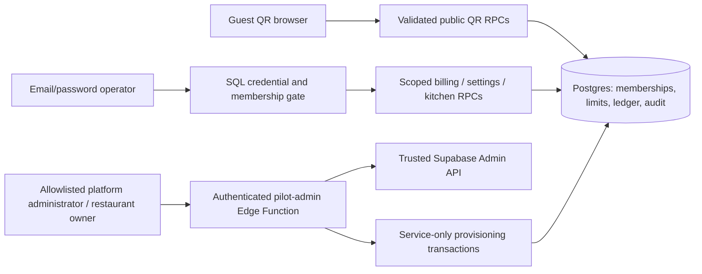

# V3.1 commercial pilot candidate

This is an extension of the verified V3 React/TypeScript/Vite application. It is a staging
candidate, not a production or legal-compliance certification. V3 ordering, tracking, tenancy,
menu management, POS, KDS, CRM and onboarding remain in place.

## Implemented boundaries

Browser role/metadata never establishes platform access. `private.platform_administrators`
is manually bootstrapped by a trusted operator and requires a confirmed Auth email.
Restaurant owners and platform administrators are separate roles. New accounts receive
individual expiring temporary credentials. The owner then completes the existing restaurant,
initial location, table and QR wizard. Platform preconfiguration of the initial location is
not implemented; that step belongs to the owner's wizard in this release.

The Edge Function validates the caller with Auth before using the secret client. SQL rechecks
the human actor, active membership, location ownership and limits. A reserved operation ID
survives uncertain Auth responses. A trusted Auth app-metadata marker identifies only that
operation's new user; an unrelated existing email is never silently claimed. Completion is
transactional and repeatable. Auth/database partial failures remain visibly unconfirmed.

`private.operator_credentials` blocks protected SQL operations until password activation.
The Edge Function verifies the current password, changes it, revokes Auth sessions globally,
then releases the SQL gate after confirming the password fingerprint changed. Direct browser
Auth password updates cannot release it. JWTs issued before activation fail the freshness gate;
the operator signs in again. Unused credentials expire after 24 hours. Legacy operators are
preserved; this migration does not force an unreviewed reset of every existing account.

## Financial and operational data

- `pilot_bills` contains immutable receipt snapshots and server totals. `pilot_bill_orders`
  prevents double billing; combined orders must share a location, currency and table session.
- `pilot_payments` is an append-only offline collection/refund/reversal ledger. Idempotency keys
  are bound to request contents. Cashiers record collections; owners/admins/managers authorize
  discounts, refunds and reversals. Reversal/refund entries reference an original payment.
- Receipt numbers are sequential per location/calendar year with a full location UUID in their
  series. They are receipt identifiers, not Indian GST tax-invoice numbers.
- `pilot_cashier_closings` records expected cash, counted cash and notes once per cashier,
  location and local business date. A closed cashier cannot post more entries that day.
- `pilot_kot_tickets` snapshots quantities, modifiers and instructions at acceptance. One ticket
  per order survives retries/reprints; status follows checked order transitions. Served/paid
  sessions close from persisted events. Existing historical timing is not fabricated.
- `pilot_daily_metrics` defines ordered amounts, issued bills, recorded collections and current
  outstanding balances separately. Empty timing/item history stays empty.
- Branding and schedules use existing restaurant/location rows. Seven-day same-day schedules
  and holiday closures are validated; configured closure is enforced when an order is inserted.
  Unconfigured hours remain explicit. Existing rates are preserved; new restaurants default to
  zero tax/service charge until an owner configures reviewed values.
- `pilot_accounts` provides manual trial/access status, user/location limits and billing/KOT
  entitlements. Enforcement is in SQL. Subscription checkout, automated provider billing and
  arbitrary plan entitlements are planned, not represented as working features.

## Reliability and limits

The existing scoped Realtime/polling and tracking mechanisms remain. Cart reconciliation marks
removed items unavailable and keeps diner inputs. A browser offline indicator describes saved
drafts honestly; there is no offline transmission queue or offline-first app shell. New SQL
requests time out after 15 seconds and Edge requests after 30; uncertain financial/provisioning
intents retain their keys across refreshes. A local draft is never described as received.

See [FILES](V3_1_FILES.md), [SECURITY_AUDIT](V3_1_SECURITY_AUDIT.md),
[TESTING](V3_1_TESTING.md) and [DEPLOYMENT](V3_1_DEPLOYMENT.md). The remaining acceptance gates
include real Supabase Auth/Data API/Realtime, independent concurrent clients, physical devices,
printer drivers, legal review, and approved production deployment.
